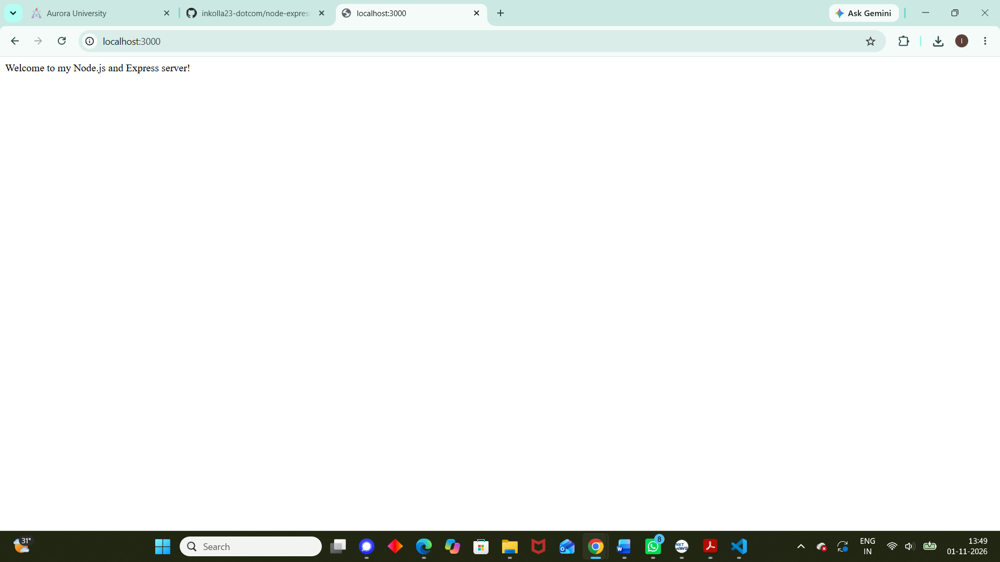
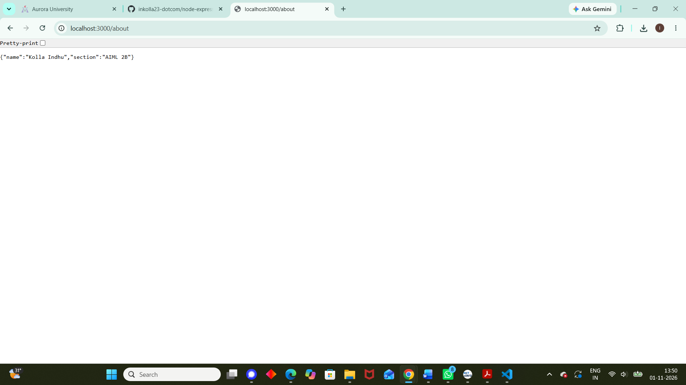

# Lab 1: Node.js and Express Server

## Student Details

- **Name:** Kolla Indhu
- **Registration Number:** 252U1R6110
- **Section:** AIML 2B

## Live Link

Not deployed yet.

## Description

A basic Node.js and Express.js server demonstrating routing, HTTP responses, JSON responses, and basic error handling.

## Installation

Install the required dependencies:

```bash
npm install
```

## Run the Application

Start the server using:

```bash
node server.js
```

The server will run at:

`http://localhost:3000`

## Endpoints

| Method | Path | Description |
|--------|------|-------------|
| GET | `/` | Returns a welcome message. |
| GET | `/about` | Returns student name and section as JSON. |
| GET | `/time` | Returns the current date and time. |
| GET | Any other path | Returns a 404 Page Not Found message. |

## Screenshots

### Home Route



### About Route



### Time Route


### 404 Error Route


## Notes

### Problems Faced

I faced minor issues while setting up the Express server and understanding route handling.

### Solution

## Screenshots

### Home Page


### About Route


### Time Route


### Error Handling
