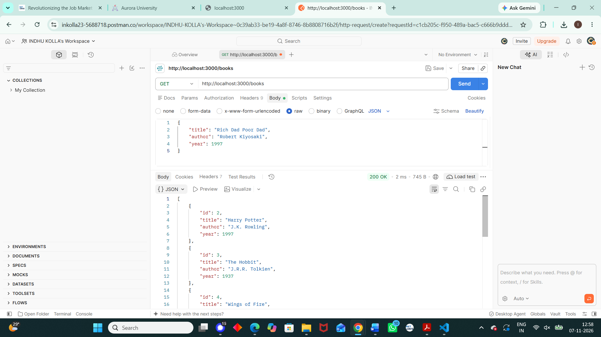
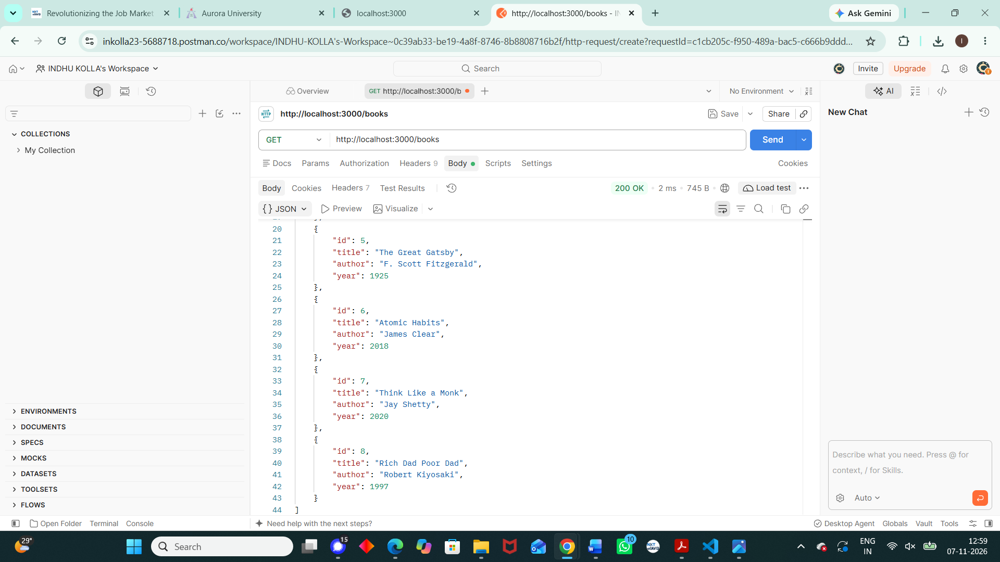
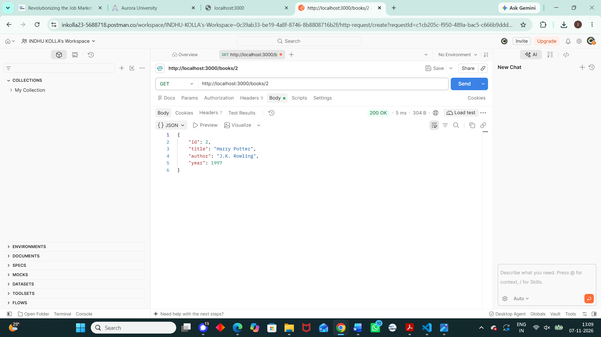
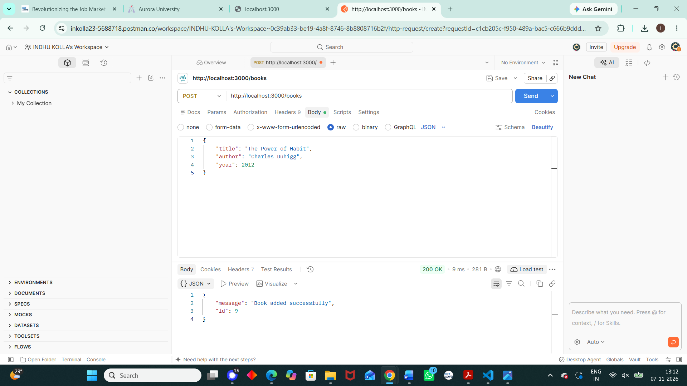
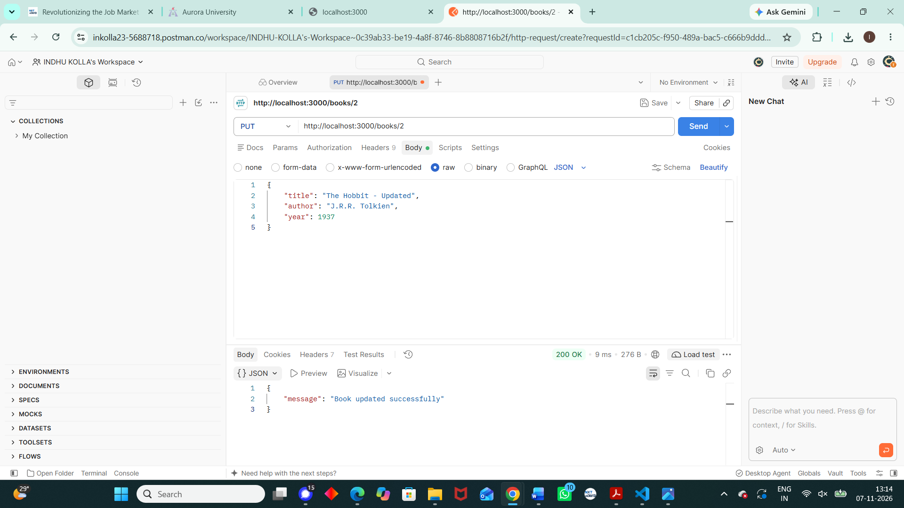

# Lab 2: SQLite Database and CRUD Routes

**Name:** Kolla Indhu  
**Registration Number:** 252U1R6110  
**Section:** AIML 2B  

## Live Link

Not deployed yet.

## Project Description

This project is a Book Management REST API developed using Node.js, Express.js, and SQLite. It performs CRUD operations on a SQLite database.

## Technologies Used

- Node.js
- Express.js
- SQLite
- Postman

## How to Install and Run

### 1. Install the dependencies

```bash
npm install
```

### 2. Start the server

```bash
npm run dev
```

The server will run at:

```text
http://localhost:3000
```

## API Endpoints

| Method | Endpoint | Description |
|--------|----------|-------------|
| GET | `/books` | Get all books |
| GET | `/books/:id` | Get a specific book using its ID |
| POST | `/books` | Add a new book |
| PUT | `/books/:id` | Update an existing book |
| DELETE | `/books/:id` | Delete a book |

## Screenshots

### Get All Books





### Get Single Book



### Add a Book



### Update a Book



### Delete a Book


## Notes

One challenge faced during this lab was setting up the SQLite database and testing the API routes. The issue was solved by connecting the database correctly with the Express server and testing each CRUD operation using Postman.

The project uses parameterized SQL queries with `?` placeholders for user input.