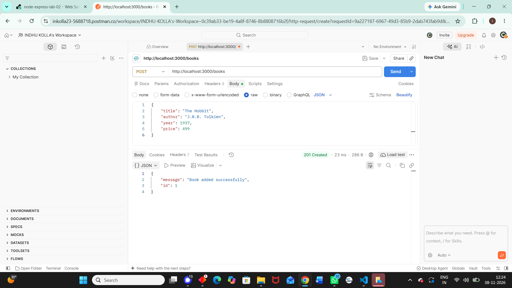
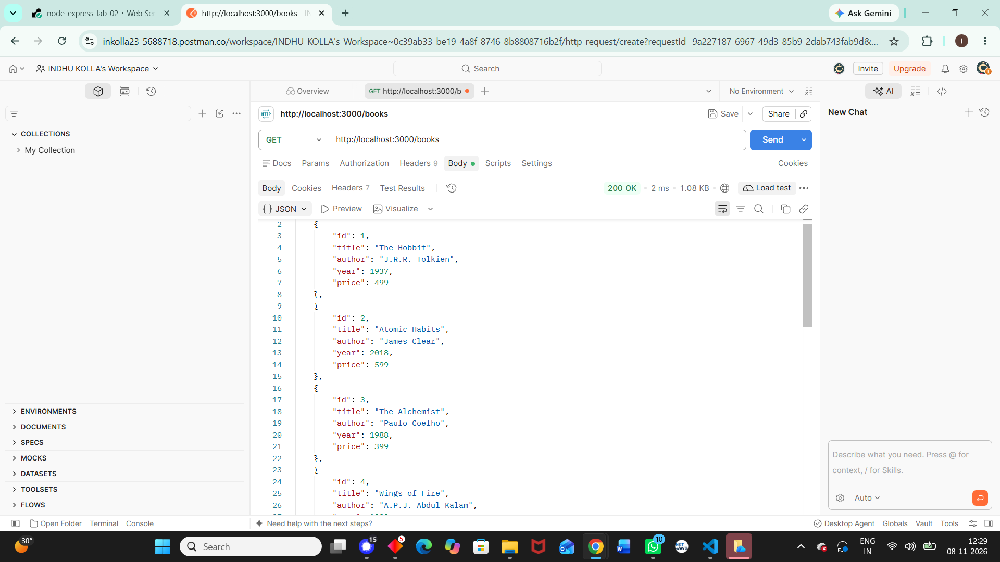
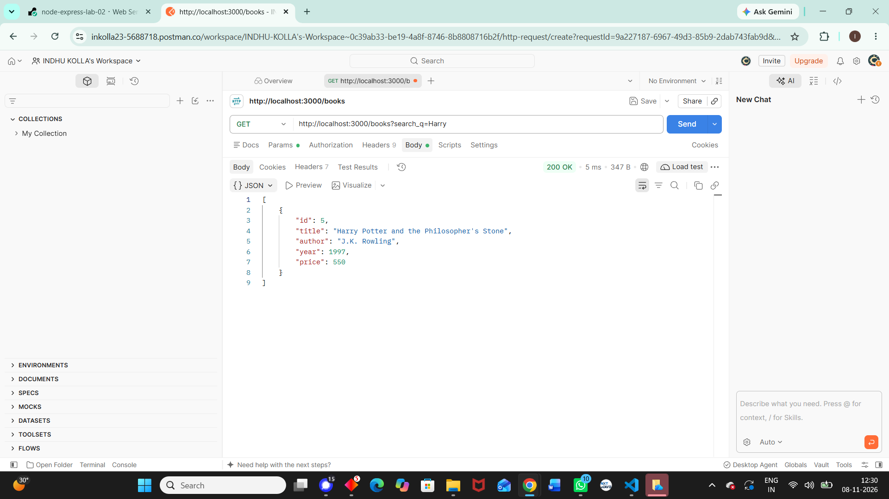
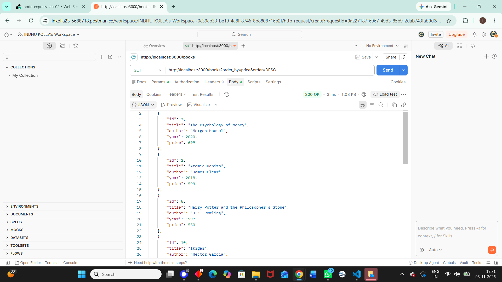
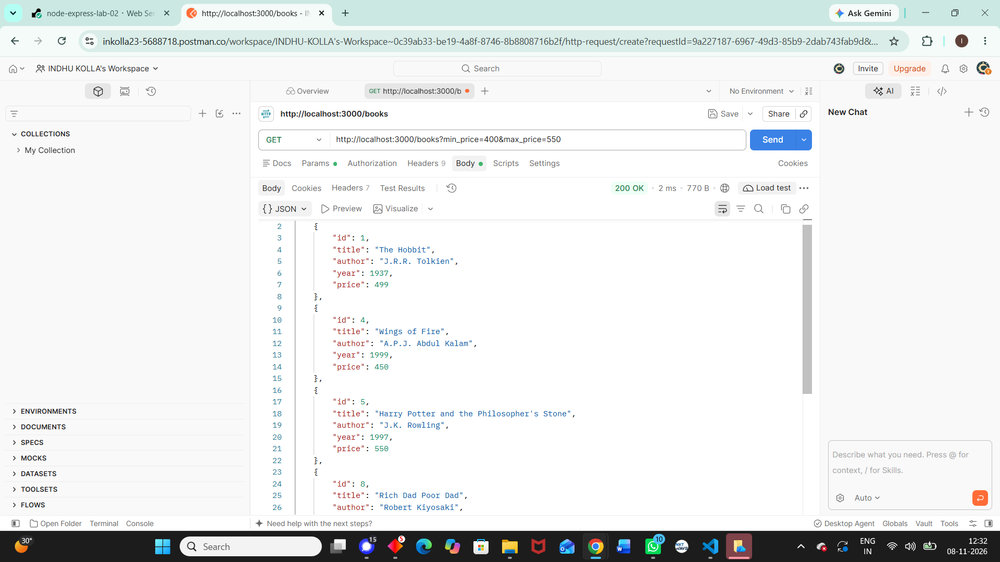
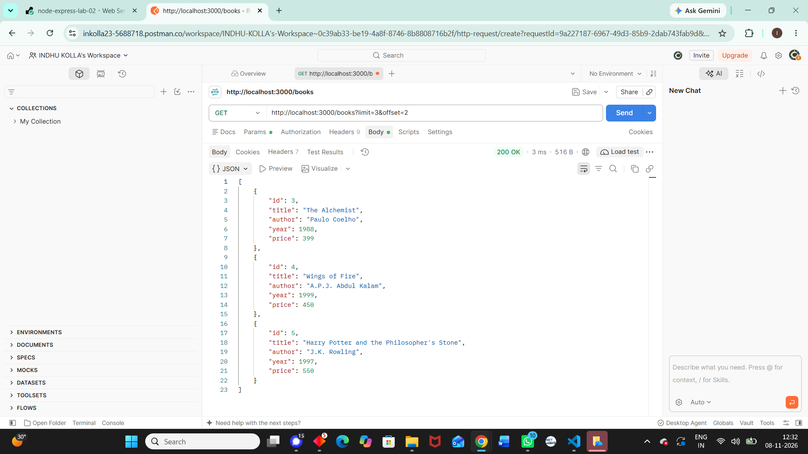
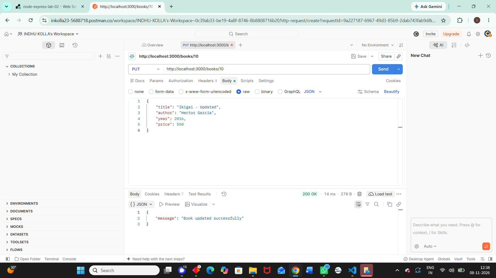
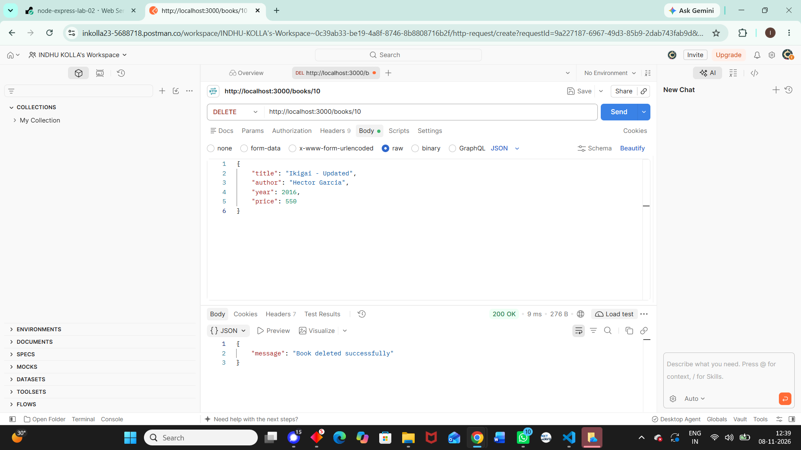
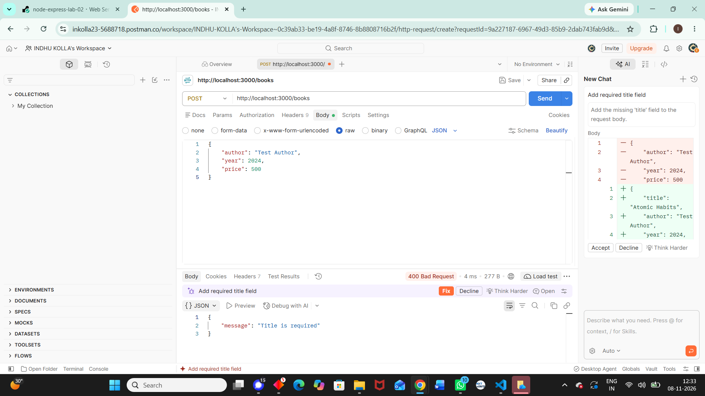
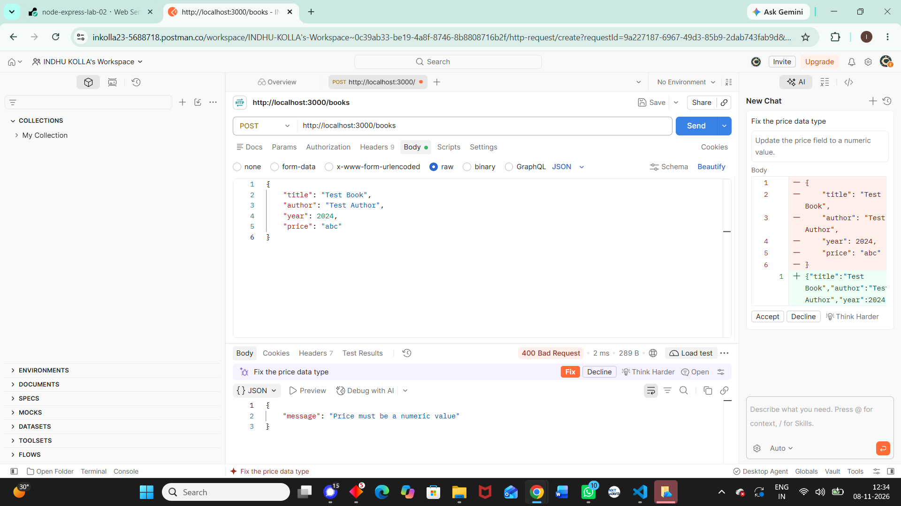

# Lab 3: REST API, Query Parameters, Validation, and Debugging

**Name:** Kolla Indhu  
**Registration Number:** 252U1R6110  
**Section:** AIML 2B  

## Live Link

Not deployed yet.

## About the Project

This project is a REST API for managing books. It was developed using Node.js, Express.js, and SQLite. The API performs CRUD operations and also supports searching, sorting, filtering, pagination, validation, and error handling.

## Technologies Used

- Node.js
- Express.js
- SQLite
- Postman

## How to Install and Run

### 1. Clone the repository

```bash
git clone <repository-url>
```

### 2. Navigate to the project folder

```bash
cd lab-03
```

### 3. Install dependencies

```bash
npm install
```

### 4. Start the server

```bash
npm run dev
```

The server will start at:

```text
http://localhost:3000
```

## API Endpoints

| Method | Endpoint | Description |
|--------|----------|-------------|
| GET | `/` | Displays a welcome message |
| GET | `/books` | Retrieves all books with query options |
| GET | `/books/:id` | Retrieves a specific book by ID |
| POST | `/books` | Adds a new book |
| PUT | `/books/:id` | Updates an existing book |
| DELETE | `/books/:id` | Deletes a book |

## Query Parameters

The `GET /books` endpoint supports the following query parameters:

| Parameter | Description |
|-----------|-------------|
| `search_q` | Searches for books using the book title |
| `order_by` | Selects the column used for sorting |
| `order` | Sorts results in ASC or DESC order |
| `limit` | Limits the number of books returned |
| `offset` | Skips a specified number of books |
| `min_price` | Filters books with a minimum price |
| `max_price` | Filters books with a maximum price |

## Validation and Error Handling

The API validates the data sent when adding a new book and returns appropriate HTTP status codes.

- **201 Created** – Book added successfully.
- **200 OK** – Successful GET, update, or delete operation.
- **400 Bad Request** – Missing required fields or invalid price.
- **404 Not Found** – Requested book does not exist.
- **500 Internal Server Error** – Server or database error.

## Postman Test Cases

The following operations were tested using Postman:

- Adding a new book.
- Retrieving all books.
- Searching for a book.
- Sorting books.
- Filtering books based on price.
- Testing pagination.
- Updating an existing book.
- Deleting a book.
- Testing validation for missing title.
- Testing validation for invalid price.
- Testing a request for a non-existing book.

## Screenshots

### 1. Add a Book



### 2. Get All Books



### 3. Search a Book



### 4. Sort Books



### 5. Filter Books by Price



### 6. Pagination



### 7. Update a Book



### 8. Delete a Book



### 9. Validation – Missing Title



### 10. Validation – Invalid Price



### 11. Book Not Found


## Problems Faced and Solutions

**Problem:** The database IDs did not restart from 1 after deleting all books.

**Solution:** The existing database file was removed and the server was restarted to create a fresh database.

**Problem:** POST requests cannot be tested directly through the browser.

**Solution:** Postman was used to test all API endpoints and verify both successful and error responses.

## Conclusion

This lab helped in understanding how to build and test a REST API using Express.js and SQLite. The project demonstrates CRUD operations, query parameters for searching, sorting, filtering and pagination, input validation, error handling, and the use of appropriate HTTP status codes.