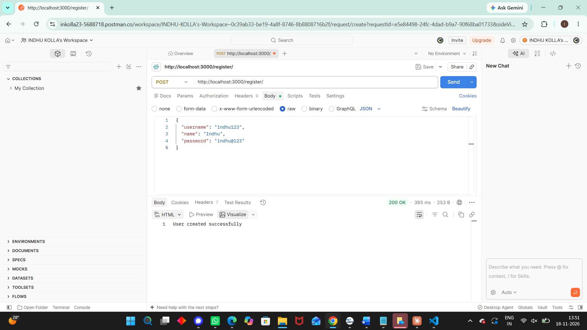
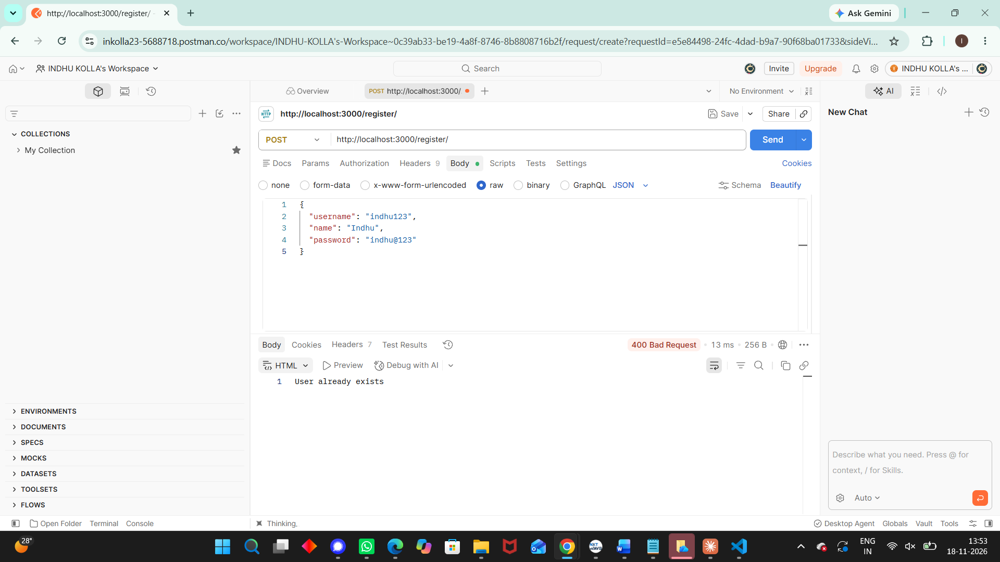
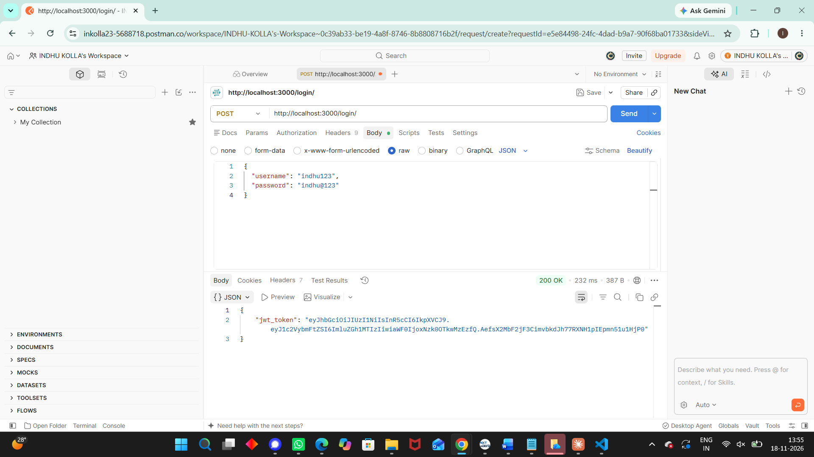
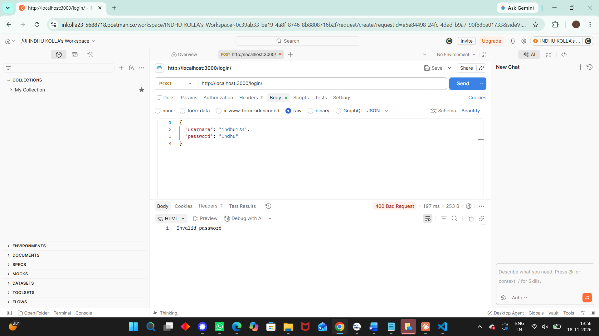
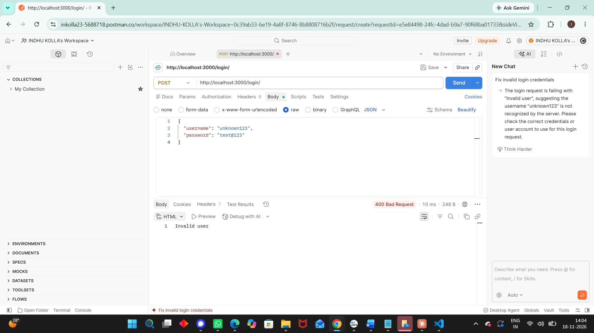
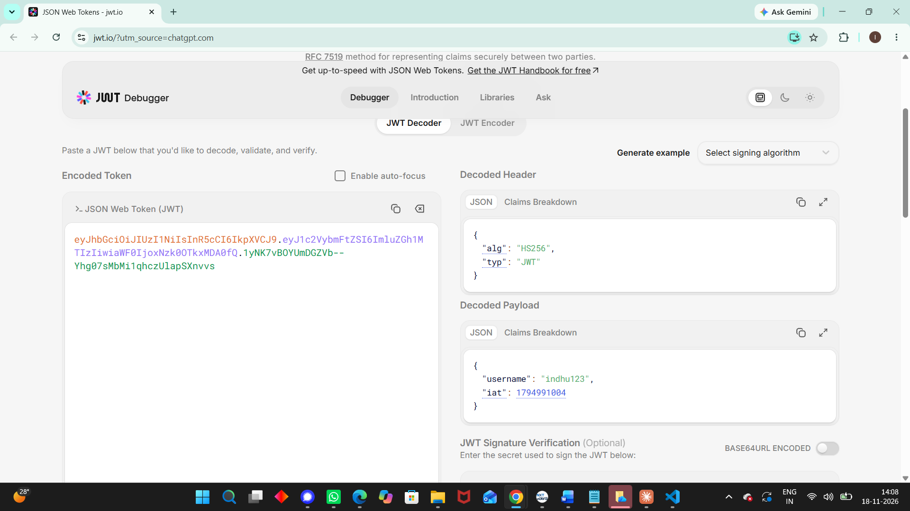
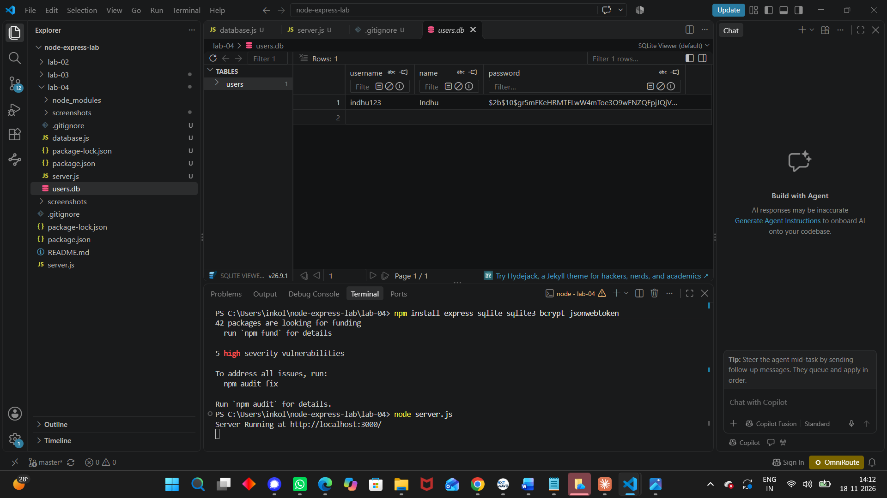

# Lab 4: Registration, Login and JWT

## Student Details

- **Name:** Kolla Indhu
- **Registration Number:** 252U1R6110
- **Section:** AIML 2B
- **Course:** Backend Development Fundamentals

## Live Link

[Lab 04 Live API](https://lab-04-auth-api.onrender.com)

## Project Description

This project implements user registration and login using Node.js, Express.js, SQLite, bcrypt and JSON Web Tokens (JWT).

It allows users to register with a username, name and password. Passwords are hashed using bcrypt before being stored in the database. During login, the entered password is compared with the stored hash. If the credentials are correct, a JWT token is generated and returned to the user.

## Technologies Used

- Node.js
- Express.js
- SQLite
- bcrypt
- JSON Web Token (JWT)
- Postman

## Project Structure

```text
lab-04/
├── screenshots/
│   ├── register-success.png
│   ├── register-duplicate.png
│   ├── login-success.png
│   ├── login-wrong-password.png
│   ├── login-invalid-user.png
│   ├── jwt-decoded.png
│   └── database-hash.png
├── database.js
├── server.js
├── package.json
├── package-lock.json
├── .gitignore
└── README.md
```

## Installation

Install the required dependencies:

```bash
npm install
```

## How to Run the Application

Start the server using:

```bash
node server.js
```

The server runs at:

```text
http://localhost:3000/
```

## API Endpoints

| Method | Endpoint | Description |
|---|---|---|
| POST | /register/ | Registers a new user and stores the hashed password. |
| POST | /login/ | Verifies user credentials and generates a JWT token. |

## Testing and Screenshots

### 1. Successful Registration

A new user is successfully registered.



### 2. Duplicate Registration

The API rejects registration with an already existing username.



### 3. Successful Login

Valid credentials return a JWT token.



### 4. Login with Wrong Password

The API rejects an incorrect password.



### 5. Login with Invalid Username

The API rejects an unregistered username.



### 6. JWT Decoding

The generated JWT is decoded to identify its header and payload.



### 7. Database Password Hashing

The database stores the password as a bcrypt hash instead of plain text.



## Security Features

- Passwords are hashed using bcrypt before storing them.
- bcrypt.compare() verifies passwords during login.
- JWT tokens are generated after successful authentication.
- Only the username is included in the JWT payload.
- Parameterized SQL queries are used to prevent SQL injection.
- Duplicate usernames are not allowed.

## Notes and Problems Faced

During implementation, the application was tested using Postman. Successful registration, duplicate registration, valid login, incorrect password and invalid username scenarios were verified.

The SQLite database was inspected to confirm that passwords are stored as hashes. JWT decoding was also performed to understand the token header and payload.

The application was tested locally. Deployment is yet to be completed.

## Conclusion

This lab helped me understand user authentication, password hashing, SQLite database operations and JWT token generation. I also learned how to test API endpoints using Postman and verify secure password storage.
